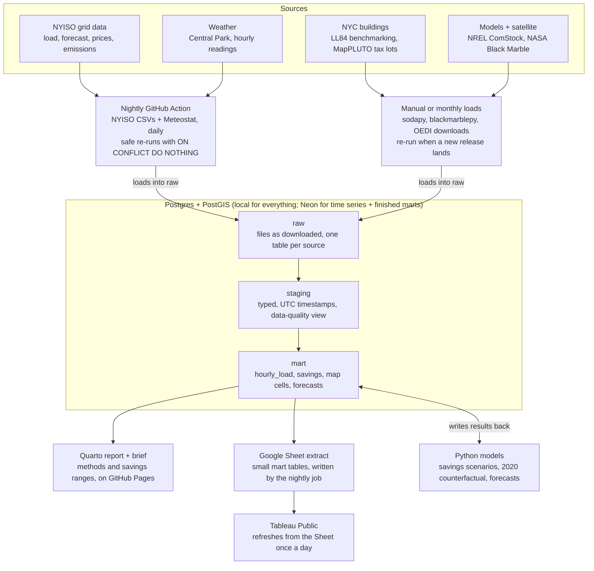

# NYC After-Hours Lighting: Project Plan

Sep 29, 2026 · revised Oct 20, 2026 · Andy Kim

This project measures when and where New York burns electricity after offices close, estimates how much of it is lighting, and prices what motion sensors or a lights-out rule would save. It runs on public data, a Postgres/PostGIS warehouse, an hourly load model and a Tableau Public dashboard, in about 10 weeks part-time.

**What changed in this revision:** the 2020 shutdown analysis was reframed (§Phase 2); ComStock now covers all five boroughs; the bill is now cited as **Int 0998-2026**, which also covers Group E (educational) buildings; the monthly Black Marble product replaces the daily one; there's a CO2 fallback including the LL97 coefficient; the savings estimate now comes before forecasting; the LL84 difference-in-differences is on hold until CY2025 data is published. Statistics were checked against primary sources. See *Implementation Plan.md*, §1, for the fact-check log.

## Framing

This statement opens the README and the policy brief.

> I'm a night owl, so I get to see a lot of New York when most everyone else is in for the night. It's a pretty beautiful sight; streets are emptier but still more populated than any street you'd find in Indiana, and the streaking of lights from street lights, food trucks, and, further downtown, flashing billboards makes being up late feel a lot more normal. It's exciting getting to see the City That Never Sleeps when most people are asleep. But since moving here, one thing that's bothered me is the light that also emanates from empty office buildings, galleries, and closed storefronts. Given the sheer quantity, I can only imagine the energy usage being a colossal waste.
>
> That's why I was inspired to create this project; I want to examine where and when New York's energy is being burnt in order to determine ways that energy could be saved. My hope is that these findings could be used to advocate for the saving of energy, spanning from the funding of motion sensors to a simple agreed upon policy that the last one out of the office will turn off the lights.

The statement commits the project to four questions:

1. **When:** How large is NYC's overnight electricity floor (1–5 a.m.), and how does it move with weekdays, holidays and the spring 2020 office shutdown, after controlling for temperature? In particular, how much of the overnight floor *didn't* move when offices emptied?
2. **How much:** What share of overnight commercial electricity goes to interior lighting, by building type?
3. **Where:** Which blocks stay bright at night while being mostly commercial floor space, and which of them dimmed when offices closed in 2020?
4. **What it's worth:** What would full sensor compliance, a Council lights-out rule, or a voluntary last-one-out norm save in MWh, dollars and tons of CO2?

**Reporting rule:** "colossal waste" is the hypothesis, and the project reports the number whatever it turns out to be. A first estimate (Implementation Plan, §2) suggests overnight lighting in the buildings the bill covers is **well under 1% of NYC's annual electricity**, and roughly 1–4% of the overnight floor. So the brief leads with absolute tons, dollars per building and the bird and light-pollution case, rather than share of the grid. An honest small number persuades a Council staffer more than an inflated one.

## Why now

A lights-out bill for private commercial buildings is now in committee, and nobody has put a public number on the energy at stake. That missing number is what this project supplies.

| Policy | What it does | Status |
| --- | --- | --- |
| [Local Law 88 of 2009](https://www.nyc.gov/assets/buildings/pdf/ll88of2009.pdf), amended by [LL134 of 2016](https://www.nyc.gov/html/gbee/downloads/pdf/ll134of2016.pdf) | Buildings over 50,000 gross sq ft (or two or more buildings on one lot totaling over 100,000 sq ft) must bring lighting up to the NYC Energy Code, including lighting controls with automatic shutoff | Deadline was Jan 1, 2025 |
| [Local Laws 30 and 31 of 2022](https://intro.nyc/local-laws/2022-31) (passed Dec 15, 2021) | City-owned buildings: nonessential outdoor lights off 11 p.m.–6 a.m. during migration (Apr 1–May 31, Aug 15–Nov 15); occupancy sensors phased in to 25% of city buildings by 2023, 40% by 2025, 75% by 2027 and all by 2030 | In force |
| [**Int 0998-2026**](https://legistar.council.nyc.gov/LegislationDetail.aspx?ID=8169984&GUID=B394ED89-C70F-43FF-8922-D468D4758EF0) ("Flaco's Law 2"; earlier versions were Int 1039-2023 and Int 896-2024) | Buildings whose main use is **Group B (business), E (educational) or M (mercantile)** must not light their interiors or exteriors at night, year-round. Exceptions: occupied areas, light required by law, seasonal storefront displays until midnight (Nov 1–Jan 15). Exemptions: non-chain stores under 4,000 sq ft. Waivers: landmarked skyline buildings of 20+ stories, pedestrian safety. Penalty $1,000 per violation; DEP enforces | Introduced Aug 13, 2026 by Harvey Epstein with 16 sponsors; in the Committee on Environmental Protection and Waterfronts; **no hearing scheduled yet** |
| [France, arrêté of 25 Jan 2013](https://www.assemblee-nationale.fr/dyn/14/questions/QANR5L14QE84260.pdf), updated Dec 2018 | Non-residential buildings turn off interior lighting an hour after the last occupant leaves; shop windows and facades off by 1 a.m. | In force since July 2013. ADEME estimated **2 TWh a year** before it took effect; in 2018 the ministry cited about [1 TWh](https://www.connexionfrance.com/article/Practical/Environment/Lights-out-for-French-businesses-every-night). Neither is a measured result |

Three benchmarks frame the scale:

- **Nationally,** lighting was about [17% of US commercial electricity](https://www.eia.gov/tools/faqs/faq.php?id=99&t=3) in 2018, roughly 208 billion kWh, across about 96 billion sq ft of commercial floor space. That's about 2.2 kWh per sq ft per year.
- **Controls:** in the 2012 CBECS survey, only [55% of large lit buildings](https://www.eia.gov/todayinEnergy/detail.php?id=31272) (50,000+ sq ft) used occupancy sensors, and 16% of all lit buildings did. A secondary summary of CBECS 2018 puts occupancy sensors at about [46% of commercial floor space](https://www.lightnowblog.com/2022/01/national-building-stock-study-reveals-ongoing-lighting-upgrade-opportunity), up from 41% in 2012. Confirm that against EIA's own 2018 tables before citing it.
- **Locally,** NYC (NYISO Zone J) used **50.1 TWh in 2025**. Load between 1 and 5 a.m. averaged **4.77 GW**, against 6.31 GW between 1 and 5 p.m. (NYISO integrated hourly load, computed for this plan).

Local Law 88 changes the question. For big buildings, sensors are already required, so part of the project asks whether that law is working. The Int 0998-2026 hearing, once it's scheduled, is where the findings are most useful. Before 2026 the real-estate industry opposed lights-out bills ([REBNY in 2015](https://therealdeal.com/2015/04/28/rebny-to-battle-lights-out-bill-wednesday/)) on safety, security and cost grounds. REBNY's position on the current bill hasn't been published, so check its testimony when the hearing comes. Either way, the brief includes a scenario where lights dim on sensors without switching off entirely.

## Data

No single public dataset shows lighting in empty buildings, so the project triangulates. Grid data gives the when, building and satellite data give the where, and NREL's building simulations give the lighting share.

| Dataset | Question it answers | Resolution | Access |
| --- | --- | --- | --- |
| NYISO integrated real-time actual load (`palIntegrated`), Zone J (N.Y.C.) | When: the overnight electricity floor | Hourly, 2001→today | Monthly CSV zips at mis.nyiso.com/public/csv/palIntegrated, or [gridstatus](https://opensource.gridstatus.io/en/latest/autoapi/gridstatus/nyiso/index.html) |
| NYISO load forecast (ISOLF) and day-ahead zonal prices (LBMP) | Benchmark for the model; the dollar value of a saved MWh | Hourly | mis.nyiso.com CSVs or gridstatus |
| [NYISO emission rates](https://www.nyiso.com/emissions-data) | Tons of CO2 per saved MWh: marginal (IMER) by zone, average for NYC | Hourly | NYISO calculators, CSV export; how far back the history goes isn't documented (check in week 1) |
| CO2 fallbacks | NYC's official factor and an EPA cross-check | Fixed factors | LL97 coefficient **0.000288962 tCO2e/kWh** (2024–2029); EPA eGRID NYCW non-baseload rate |
| Central Park hourly weather (KNYC) | Temperature control, so heat waves aren't mistaken for waste | Hourly | Meteostat library (confirm the station ID) or NOAA ISD |
| [LL84 benchmarking](https://data.cityofnewyork.us/Environment/NYC-Building-Energy-and-Water-Data-Disclosure-for-/5zyy-y8am), annual, plus [monthly](https://catalog.data.gov/dataset/local-law-84-monthly-data-calendar-year) (`fvp3-gcb2`) | Where: electricity use per building (private 25,000+ sq ft, city-owned 10,000+ sq ft) | Annual (report years 2022–2024); monthly for **CY2018–2021, 2023, 2024** (no 2022, no 2025 yet) | NYC Open Data API (sodapy) |
| MapPLUTO (release 26v2) | Land use, building class, floor area by use, and shape for every tax lot | Per lot | NYC Dept. of City Planning |
| [NREL ComStock](https://comstock.nrel.gov/page/datasets) | How much: interior lighting's share of commercial load at each hour, by building type | 15-min, modeled, by county: **all five NYC counties** (36005, 36047, 36061, 36081, 36085) | OEDI data lake (pre-aggregated county time series) |
| [NASA Black Marble](https://worldbank.github.io/blackmarblepy/README.html), **VNP46A3 monthly** (plus VNP46A2 daily for spring 2019 and 2020) | Where: how bright each area is at night, and which areas dimmed in 2020 | 15 arc-seconds (~500 m); monthly snow-free composite with a quality flag | blackmarblepy (supports A1–A4) plus a free NASA Earthdata token |

The satellite crosses NYC around [1:30 a.m. local solar time](https://science.nasa.gov/earth/earth-observatory/night-lights-2012-the-black-marble-79803/): about 1:25 a.m. EST, or 2:25 a.m. during daylight time. Either way, that's inside the hours this project is about.

## Architecture

Nightly jobs load one database; the dashboard reads only its marts.

Everything lands in one local Postgres database in three layers, built with dbt Core. The models and every output read from the `mart` layer, so a fix in SQL shows up everywhere at once. The hosted copy on Neon (free tier: 1 GB per project, PostGIS included) holds only the time series and the finished marts. MapPLUTO geometry is too big to put there.

## The path

Six phases take about 10 weeks at 8–10 hours a week. The savings estimate now comes before modeling, because it's the number the Council doesn't have. Phases 3 and 4 overlap. Each phase ends with a check that can be verified.

### Phase 0: Setup (week 1)

**Tools:** Git/GitHub, PostgreSQL + PostGIS, Python (uv or venv), dbt Core

1. Create the repo with `ingest/`, `sql/` (dbt project), `models/`, `dashboard/`, `report/` folders. Put the statement at the top of the README.
2. Install Postgres.app with PostGIS locally. Create a free Neon project with PostGIS for the nightly job. (Supabase's free tier pauses after a week without activity and has 500 MB.)
3. Set up three schemas: `raw` (data exactly as downloaded), `staging` (cleaned and typed), `mart` (tables the dashboard reads).
4. Get credentials: a NASA Earthdata token, an NYC Open Data app token and a Google service account. Store them as GitHub Actions secrets, never in code.
5. **Check access to each source** with a throwaway script, and record what you find in `docs/access_log.md`. Look especially at how much history NYISO's emission calculator allows, which ComStock release has county aggregates and whether it includes an interior-lighting-controls upgrade, and whether LL84 CY2025 monthly data has been published.

**Done when:** `psql` connects to both databases, the schemas exist, and the access log is filled in.

### Phase 1: Ingestion (weeks 1–3)

**Tools:** Python (requests/gridstatus, sodapy, meteostat, blackmarblepy, pandas, SQLAlchemy), GitHub Actions

1. **Grid:** pull Zone J integrated hourly load from 2016 to today, plus NYISO's archived day-ahead forecast and Zone J day-ahead and real-time prices. Load into `raw.nyiso_load`, keyed on (zone, timestamp).
2. **Weather:** hourly Central Park temperature and humidity for the same span.
3. **Buildings:** LL84 annual and monthly tables and MapPLUTO for all five boroughs. The join key is BBL, the borough-block-lot ID. Split LL84 rows that list several BBLs before joining.
4. **ComStock:** download the county aggregates for **all five NYC counties**, baseline scenario (plus the lighting-controls upgrade if the release has one), split by building type and end use. Keep interior lighting, exterior lighting, interior equipment and total. List the PLUTO and LL84 building types that have no ComStock match.
5. **Satellite:** VNP46A3 monthly composites clipped to NYC, 2019 to today, keeping the quality flag. Separately, pull VNP46A2 daily for March–June 2019 and March–June 2020.
6. **Automate:** a nightly GitHub Actions job appends new grid, price and weather rows with `INSERT ... ON CONFLICT DO NOTHING`, so re-runs are safe. LL84, PLUTO, ComStock and satellite data stay manual or monthly.

**Watch for:** NYISO timestamps are Eastern time with an EST/EDT flag. The November fall-back hour appears twice, so store everything in UTC. Overnight "1–5 a.m." is local time, so compute it as a mean: DST nights have 3 or 5 hours in that window.

**Done when:** a `staging.data_quality` view (or dbt tests) shows no missing hours or duplicate keys, and row counts match the sources.

### Phase 2: SQL modeling and exploration (weeks 3–5)

**Tools:** SQL (CTEs, window functions, PostGIS spatial joins), dbt Core

1. **`mart.hourly_load`:** load joined to temperature, heating and cooling degree hours, and calendar flags (weekday, federal holiday, the 2020 PAUSE and reopening phases).
2. **Overnight floor:** average 1–5 a.m. load by month; night-to-day ratio; weekday nights vs. weekend nights. Use `AVG() OVER` windows for rolling 28-day versions. First look from 2025: weekday nights averaged 4,792 MW and weekend nights 4,707 MW, only about 85 MW apart.
3. **Natural experiment, reframed:** compare April–May 2020 with the same weeks in 2019 at matched temperatures, **for daytime and overnight hours separately**. The drop is a net number (commercial load fell, home load rose), and it captures only load that responds to occupancy. Lights burning in empty towers don't show up in it. So the finding to report is the contrast: if daytime load fell sharply while the overnight floor barely moved, overnight commercial load doesn't depend on whether anyone is in the building. Phase 4 refines this with a weather-adjusted counterfactual.
4. **Lighting share:** from ComStock, interior lighting's share of commercial electricity at 1–5 a.m. vs. 1–5 p.m., by building type and county. Plot each type's 24-hour lighting profile, because the overnight value is an assumed schedule. DOE's reference office schedule has lights at 5% overnight.
5. **Where:** a PostGIS join of Black Marble cells to PLUTO lots gives each cell its commercial floor-area share. Rank cells that are both bright at night and mostly commercial, by percentile within each borough (the sensor saturates in Midtown). Then map each cell's change in brightness from spring 2019 to spring 2020.
6. **Buildings:** electricity per sq ft by LL84 property type (office, retail, school, museum, and others). Flag LL88-covered buildings (over 50,000 sq ft, or over 100,000 on a multi-building lot) and buildings the bill would cover (Groups B, E and M, minus exemptions).

**Done when:** questions 1–3 from the Framing section can each be answered with a query.

### Phase 3: Savings estimate (weeks 5–7)

**Tools:** SQL, Python, and an Excel scenario sheet (useful practice with Data Tables)

1. **Bottom-up:** commercial floor area by type (PLUTO and LL84) × overnight lighting kWh per sq ft (ComStock) × the share of that lighting a policy removes. PLUTO 26v2 has 483M sq ft in office buildings, 166M in store buildings and 250M in educational buildings, about 0.9 billion sq ft that roughly matches the bill's B/E/M scope.
2. **Three scenarios:**
   - (a) LL88 fully complied with: the gap between ComStock's baseline and its lighting-controls upgrade for buildings over 50,000 sq ft, minus an assumed rate of existing compliance.
   - (b) An Int 0998-2026-style rule for Group B, E and M buildings, in two versions: **off**, and **dimmed to 30% on sensors** (the safety variant). Include exterior lighting, since the bill covers it.
   - (c) A voluntary last-one-out norm at 25%, 50% and 75% uptake.
3. **Value it:** MWh × overnight Zone J day-ahead price (a lower bound; it averaged $49/MWh between 1 and 5 a.m. in 2025) and a commercial retail rate (an upper bound; about 18–21¢/kWh statewide in 2025, higher in Con Ed territory) gives dollars. For CO2, multiply MWh by three factors: NYISO's marginal rate, the LL97 coefficient (the number Council staff already use) and EPA eGRID.
4. **Sanity bounds:** savings must be less than ComStock's total overnight lighting for the buildings in scope, which must be less than the Zone J overnight floor × the commercial share. Compare with France's 1–2 TWh scaled by commercial floor area, and with the first estimate in the Implementation Plan. If any bound fails, explain why. (The original check, that savings "sit inside the 2020 shutdown drop," was dropped: lights left on in empty buildings wouldn't be in that drop.)
5. **Sensitivity:** a Monte Carlo over the key assumptions gives low, central and high values (P10, P50, P90), and a tornado chart shows which assumption moves the answer most. Expect the overnight on-fraction to top it.
6. **Stretch, causal (on hold):** difference-in-differences on LL84 monthly data, with LL88-covered buildings as the treatment group and 25,000–50,000 sq ft buildings as the control, before and after the Jan 2025 deadline. The monthly data currently stops at CY2024, so this waits until CY2025 is published. If it lands in time, add a regression discontinuity at the 50,000 sq ft threshold. Upgrades were phased in since 2010, so expect a small effect, and report a null result if that's what comes out.

**Done when:** each scenario has a range (low, central, high) in MWh, dollars and CO2, with every assumption cited.

### Phase 4: Counterfactual and forecasting (weeks 6–8)

**Tools:** Python (statsmodels, LightGBM, scikit-learn), or R (fable) if preferred

1. **Counterfactual 2020 (priority):** fit on Jan 2016–Feb 2020, then predict March–July 2020 at the weather that actually occurred. The gap between predicted and actual load, hour by hour, with a bootstrap interval, is the shutdown effect controlled for temperature. Report it separately for day and night. This sharpens Phase 2.3 and is the headline for question 1.
2. **Production forecast (if time allows):** Zone J hourly load, 1–7 days ahead. Benchmarks first: seasonal naive (same hour last week), plus NYISO's own forecast. The model has to beat the first, and it will be judged against the second.
3. **Models:** (a) regression on calendar dummies and temperature splines with ARIMA errors; (b) LightGBM on lags, calendar and temperature features. Optionally, MSTL decomposition to show the daily, weekly and yearly cycles.
4. **Backtest:** rolling origin over the last 12 months. Report MAPE and interval coverage overall and for 1–5 a.m. separately, since overnight accuracy is what this project needs.
5. **Store:** write `mart.forecasts(issued_at, target_ts, model, yhat, lo, hi)`. The nightly job adds tomorrow's forecast so the dashboard can show forecast against actual over time.
6. **Scenario layer:** subtract Phase 3's after-hours lighting load from the forecast to draw a "with policy" curve for each scenario.

**Done when:** the counterfactual gives a day and night shutdown effect with intervals. If the production forecast is built, the best model beats seasonal naive in the backtest, and it's clear where it loses to NYISO.

### Phase 5: Dashboard (weeks 8–9)

**Tools:** Tableau Public, Google Sheets (gspread)

Design for one reader: a Council staffer preparing for the Int 0998-2026 hearing.

1. **When:** last week's load (plus tomorrow's forecast, if built) with the overnight band shaded; the monthly night-to-day ratio; the 2020 day vs. night counterfactual gap.
2. **Where:** a map of nighttime brightness against commercial share, with a layer for the change from 2019 to 2020; click a cell to see its building mix by type, not individual buildings named as wasteful.
3. **What it's worth:** a savings calculator using Tableau parameters for scenario, off vs. dim, and uptake, showing MWh, dollars, CO2 and a homes-powered equivalent. A NY household averaged 566 kWh a month in 2023 ([EIA](https://www.eia.gov/electricity/sales_revenue_price/pdf/table_5A.pdf)); NYC apartments use less, so say which figure you used.
4. **Trust:** backtest accuracy against NYISO's forecast, plus the assumptions behind the savings range.

**Refresh:** Tableau Public auto-refreshes from [Google Sheets](https://irarickman.com/blog/Auto-Refreshing-Tableau-Public/) once a day. The nightly job writes small `mart` extracts to a Sheet with gspread. Keep them aggregated, since Sheets has a cell limit. Cell geometry doesn't change, so ship it as a static GeoJSON joined on cell ID. Power BI's online service generally requires a work or school account, and Columbia's tenant may block it, so Tableau is the easier public route.

**Done when:** the dashboard updates overnight for 7 days in a row with no manual steps.

### Phase 6: Deploy and publish (weeks 9–10)

**Tools:** Quarto, GitHub Pages

1. **Repo:** README (statement, three headline numbers, dashboard link, architecture diagram), setup instructions and a data dictionary.
2. **Report:** a Quarto write-up on GitHub Pages covering methods, the 2020 counterfactual, savings ranges and limitations.
3. **Policy brief:** two plain-language pages built around Int 0998-2026. Possible recipients are Council Member Epstein's office, the NYC Bird Alliance and the Lights Out coalition. Contact them by week 5; they may have field audits of after-hours lighting, the input that drives the estimate most.
4. **Career:** a resume bullet and a LinkedIn post that link the dashboard.

**Done when:** a stranger can clone the repo, follow the README, and reproduce the numbers.

## Risks and limits

The biggest limit is that no public dataset measures lighting in empty buildings directly. Every estimate is a triangulation, and the report should say so up front.

| Risk | Why it matters | How to handle it |
| --- | --- | --- |
| Grid load mixes everything | Zone J load includes homes, subways and data centers, not only offices | Use it for timing and bounds; take the lighting share from ComStock |
| The shutdown drop gets misread | The drop is net of rising home load, and lights left on in empty buildings aren't in it | Compare day with night; use the weather-adjusted counterfactual; make no "savings must fit inside the drop" claim |
| ComStock is simulated | Its overnight lighting comes from assumed schedules (5% for DOE's reference office), not meters | Call it modeled; put the on-fraction at the top of the tornado chart; look for field audits through the advocates |
| ComStock doesn't model every building type | Some PLUTO/LL84 types have no ComStock match | List the gaps in the data dictionary; use the nearest type or leave the building out, and say which |
| Satellite light isn't building light | Upward light is mostly streets, signs and facades; each cell is about 500 m wide; Midtown saturates | Compare commercial with residential cells; rank within each borough; use the 2020 change in brightness; never claim a specific building is wasteful |
| LL84 is self-reported and annual | Some entries are wrong, annual totals hide overnight use, and the monthly data has no 2022 or 2025 yet | Drop outliers within each property type; use it for "where", not "when"; hold the causal stretch until CY2025 is published |
| Overnight power is cheap | 2025 overnight day-ahead prices averaged $49/MWh vs. $65 across all hours | Show wholesale and retail bounds, and lead with MWh and CO2 |
| Safety objections | Industry groups have opposed past lights-out bills on security and operations grounds | Include a sensor-dimming scenario that keeps lights on where people are |
| The bill changes | Number, scope or sponsor can change before a hearing | Check Legistar in weeks 1, 5 and 9; describe the bill by what it does, not only its number |
| Scope creep | Eight datasets is a lot for 10 weeks | Core = Phases 0–3 (grid, weather, ComStock, PLUTO/LL84 → questions 1, 2 and 4); the satellite map, dashboard and counterfactual come next; the production forecast and causal stretch are optional |

## Sources

- [Local Law 88 of 2009](https://www.nyc.gov/assets/buildings/pdf/ll88of2009.pdf) and [Local Law 134 of 2016](https://www.nyc.gov/html/gbee/downloads/pdf/ll134of2016.pdf), NYC
- [Local Law 88: lighting upgrades and submetering](https://www.ny-engineers.com/blog/local-law-88-lighting-upgrades-and-submetering), NY Engineers
- [Local Law 31 of 2022](https://intro.nyc/local-laws/2022-31) and [Local Law 30 of 2022](https://intro.nyc/local-laws/2022-30), intro.nyc
- [New York City passes landmark lights-out laws](https://www.allaboutbirds.org/news/new-york-city-passes-landmark-lights-out-laws/), Cornell Lab of Ornithology
- [Int 0998-2026, Limiting nighttime illumination for certain buildings](https://legistar.council.nyc.gov/LegislationDetail.aspx?ID=8169984&GUID=B394ED89-C70F-43FF-8922-D468D4758EF0), NYC Council Legistar
- [NYC lawmakers rally to force office towers to dim lights for birds](https://hoodline.com/2026/08/nyc-lawmakers-rally-at-city-hall-to-force-office-towers-to-dim-lights-for-birds/), Hoodline, Aug 2026
- [Flip the switch: lawmakers rally for Lights Out bill](https://www.amny.com/news/lawmakers-new-yorkers-lights-out-bill-birds/), amNY, Aug 2026
- [Support for limiting nighttime illumination (Int 896-2024)](https://www.nycbar.org/reports/support-for-limiting-nighttime-illumination-for-certain-buildings-to-reduce-bird-collisions-injuries-and-death/), NYC Bar, Sep 2025
- [REBNY to battle lights-out bill](https://therealdeal.com/2015/04/28/rebny-to-battle-lights-out-bill-wednesday/), The Real Deal, 2015
- [Written question 84260 and ministerial answer on the 2013 arrêté](https://www.assemblee-nationale.fr/dyn/14/questions/QANR5L14QE84260.pdf), Assemblée nationale
- [Lights out for French businesses every night](https://www.connexionfrance.com/article/Practical/Environment/Lights-out-for-French-businesses-every-night), Connexion France
- [France in the dark: lighting legislation](https://www.thelightingpractice.com/france-in-the-dark-on-lighting-legislation/), The Lighting Practice
- [How much electricity is used for lighting?](https://www.eia.gov/tools/faqs/faq.php?id=99&t=3), EIA
- [Large commercial buildings are more likely to use lighting controls](https://www.eia.gov/todayinEnergy/detail.php?id=31272), EIA
- [National building stock study reveals ongoing lighting upgrade opportunity](https://www.lightnowblog.com/2022/01/national-building-stock-study-reveals-ongoing-lighting-upgrade-opportunity), LightNow (CBECS 2018 summary)
- [Average monthly bill, residential (Table 5A)](https://www.eia.gov/electricity/sales_revenue_price/pdf/table_5A.pdf), EIA
- [DOE reference building characteristics (lighting schedules)](https://www1.eere.energy.gov/buildings/appliance_standards/pdfs/ashrae_final_rule_tsd_app04a_characteristics_2012_05_01.pdf), DOE, 2012
- [Local Law 97 rules](https://rules.cityofnewyork.us/rule/procedures-for-reporting-on-and-complying-with-annual-greenhouse-gas-emissions/), NYC
- [gridstatus NYISO reference](https://opensource.gridstatus.io/en/latest/autoapi/gridstatus/nyiso/index.html)
- [NYISO emissions data](https://www.nyiso.com/emissions-data)
- [LL84 benchmarking, annual](https://data.cityofnewyork.us/Environment/NYC-Building-Energy-and-Water-Data-Disclosure-for-/5zyy-y8am) and [monthly](https://catalog.data.gov/dataset/local-law-84-monthly-data-calendar-year), NYC Open Data
- [ComStock public datasets](https://comstock.nrel.gov/page/datasets) and [Interior Lighting Controls measure documentation](https://research-hub.nrel.gov/en/publications/comstock-measure-documentation-interior-lighting-controls/), NREL
- [VNP46A3 dataset page](https://www.earthdata.nasa.gov/data/catalog/laads-vnp46a3-1), NASA Earthdata
- [Night Lights 2012: The Black Marble](https://science.nasa.gov/earth/earth-observatory/night-lights-2012-the-black-marble-79803/), NASA Earth Observatory
- [BlackMarblePy](https://worldbank.github.io/blackmarblepy/README.html), World Bank
- [Neon pricing](https://neon.com/pricing) and [Supabase pricing](https://supabase.com/pricing)
- [Auto-refreshing Tableau Public](https://irarickman.com/blog/Auto-Refreshing-Tableau-Public/), Ira Rickman
